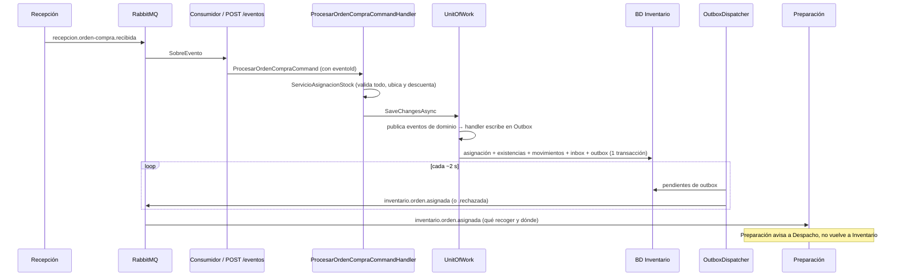

# Inventario — Arquitectura

Microservicio .NET 10 del contexto **Inventario**, con DDD, CQRS ligero y eventos. Ver también [FLUJO_Y_EVENTOS.md](FLUJO_Y_EVENTOS.md) y [ENDPOINTS.md](ENDPOINTS.md).

## 1. Agregados

| Agregado | Responsabilidad | Reglas principales |
|---|---|---|
| `Producto` | Ficha del producto: sku, nombre, descripción, marca, modelo, categoría, unidad y características libres | SKU único; lo da de alta la simulación de compra (mientras no exista Compras) |
| `Ubicacion` | Lugar físico con stock: bodega, tienda, otro | Código único (`UBI-002`); `prioridad` ≥ 0 (`UBI-003`) define el orden de recogida |
| `Existencia` | Unidades de un producto **en una ubicación** | Una por (producto, ubicación); no se descuenta más de lo que hay (`EXI-002`); token de concurrencia `Version` |
| `AsignacionOrden` | Resultado de procesar una orden de compra | Una por `ordenCompraId`; `Asignada` (con detalle de qué recoger en cada ubicación) o `Rechazada` (con errores `ORD-1xx`) |
| `MovimientoStock` | Kardex por ubicación | Tipos `Entrada, Salida`; inmutable |
| `InventarioProducto` | Salud del inventario (agregado "Inventario" del modelo) | Stock mínimo ≥ 0 (`INV-001`) sobre el **total** de todas las ubicaciones; avisa `bajo-minimo` solo al cruzar el umbral |

La regla "validar todo y luego descontar repartiendo entre ubicaciones" abarca varios productos y existencias, por eso vive en el servicio de dominio `ServicioAsignacionStock`:
1. Cada línea debe identificar un producto registrado y pedir cantidad > 0 (`ORD-101`, `ORD-104`, `ORD-105`).
2. Por producto, la suma de todas las ubicaciones debe alcanzar (`ORD-102`, `ORD-103`). Se juntan **todos** los problemas antes de rechazar.
3. Si no hay errores, descuenta recorriendo las ubicaciones por prioridad (y, a igual prioridad, la que tenga más unidades).

Los códigos de error viven en un solo lugar, `CatalogoErrores` (`Inventario.Dominio.Comun`); las excepciones y los rechazos los toman de ahí y `GET /api/inventario/errores/catalogo` los expone.

> La clase se llama `InventarioProducto` y no `Inventario` porque `Inventario` es el espacio de nombres raíz de la solución; una clase con el mismo nombre obligaría a calificarla en todas las capas.

## 2. Estructura de la solución

```
Inventario.slnx
Api/
  Inventario.Api/                       Host: Program.cs, controladores, ApiResponse, manejo de errores, registro del mediador
Compartido/
  Inventario.Contratos/                 Eventos de integración públicos (SobreEvento, CatalogoEventos). Sin dependencias
  Inventario.Mediador/                  Mediador propio (CQRS): ICustomMediator, IRequestHandler, IEventHandler, PoliticaReintentos
Dominio/
  Inventario.Dominio.Comun/             Excepciones de dominio con código (Validacion / NoEncontrado / Conflicto)
  Inventario.Dominio.Eventos/           Eventos de dominio (internos)
  Inventario.ObjetosValor/              Cantidad, Sku, Nombre
  Inventario.Agregados/                 Agregados, entidades y servicio de dominio
  Inventario.RepositorioContrato/       Puertos de repositorio, IUnitOfWork, inbox
Aplicacion/
  Inventario.Aplicacion.Dto/            DTOs y mapeos
  Inventario.Aplicacion.Command(.Handler)/  Comandos (escriben)
  Inventario.Aplicacion.Query(.Handler)/    Consultas (leen)
  Inventario.Aplicacion.Notification.Handler/  Evento de dominio → evento de integración en la Outbox
  Inventario.MensajeriaContrato/        Puertos IBandejaSalida (Outbox) e IPublicadorEventos (broker)
Infraestructura/
  Inventario.Infraestructura.Configuracion/  Configuraciones EF por agregado
  Inventario.Infraestructura.Modelo/    DbContext, tablas outbox y eventos_recibidos
  Inventario.Infraestructura.Repositorio/  Repositorios EF, UnitOfWork, Outbox/Inbox EF
  Inventario.Infraestructura.Mensajeria/   OutboxDispatcher, ReceptorEventos, RabbitMQ (publicador/consumidor), publicador Log
docs/

Nuevo agregado (receta): entidad en Dominio/Inventario.Agregados → puerto en Dominio/Inventario.RepositorioContrato →
comando/query + handler en Aplicacion/ → configuración EF en Infraestructura/...Configuracion + DbSet en ...Modelo +
repositorio en ...Repositorio → registrar repositorio en Program.cs → controlador en Api/. Los handlers se registran solos.
```

## 3. Cómo viaja un cambio



## 4. Patrones

| Patrón | Dónde |
|---|---|
| CQRS ligero con mediador propio | `ICustomMediator.SendAsync` → `IRequestHandler<,>`; handlers registrados por escaneo de ensamblados (`RegistroMediador`) |
| Eventos de dominio | Los agregados llaman `AddDomainEvent`; `UnitOfWork` los entrega con `PublishAsync` a los `IEventHandler<T>` **antes** de guardar |
| Outbox transaccional | `PublicarEventosIntegracionHandler` → `IBandejaSalida` → tabla `outbox`; `OutboxDispatcher` publica |
| Inbox / idempotencia | Tabla `eventos_recibidos` por `eventoId`, en la misma transacción que el efecto |
| Concurrencia optimista | `Existencia.Version`; conflicto → `GEN-409` (el consumidor lo reintenta) |
| Catálogo de errores | `CatalogoErrores`: un único origen para los códigos de excepciones HTTP y motivos de rechazo |
| Respuesta estándar | `ApiResponse` (`success, code, message, timestamp, traceId, data / errors, path`) |

## 5. Configuración (`appsettings.json`)

| Clave | Valores | Por defecto |
|---|---|---|
| `BaseDatos:Proveedor` | `InMemory`, `SqlServer`, `PostgreSQL` | `InMemory` (arranca sin instalar nada) |
| `ConnectionStrings:SqlServer` / `PostgreSQL` | cadena de conexión | — |
| `Mensajeria:Proveedor` | `Log` (sin broker), `RabbitMq` | `Log` |
| `Mensajeria:RabbitMq:*` | host, credenciales, exchange, colas | `localhost`, `taller.eventos`, `inventario.eventos` |

## 6. Ejecución local

```
dotnet build Inventario.slnx
dotnet run --project Api/Inventario.Api --launch-profile http     # http://localhost:5180
```
Probar con `Api/Inventario.Api/Inventario.Api.http`. Con broker: `docker compose up -d` y `"Mensajeria:Proveedor": "RabbitMq"`.

## 7. Pendientes conocidos

- **Migraciones:** hoy se usa `EnsureCreated()`. Al fijar el motor de BD, generar migraciones (`dotnet ef migrations add Inicial`) y cambiar a `Database.Migrate()`.
- **Varias instancias:** el `OutboxDispatcher` no bloquea filas; para escalar horizontalmente agregar `FOR UPDATE SKIP LOCKED` (PostgreSQL) o `UPDLOCK, READPAST` (SQL Server).
- **InMemory** no tiene transacciones reales; usar SqlServer/PostgreSQL para validar atomicidad.
- **Autenticación:** ningún endpoint está protegido.
- Acordar con Recepción el nombre de `recepcion.orden-compra.recibida` y si envía `productoId` o `sku` (ver FLUJO §1).
- **Compras:** cuando exista, reemplazar `POST /compras/simular` por el consumo de su evento de ingreso.
- **Base de datos existente:** el modelo cambió (ubicaciones, productos, asignaciones). `EnsureCreated()` no altera tablas ya creadas: borrar la BD de pruebas o generar migraciones.
